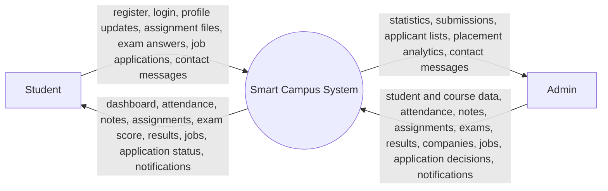
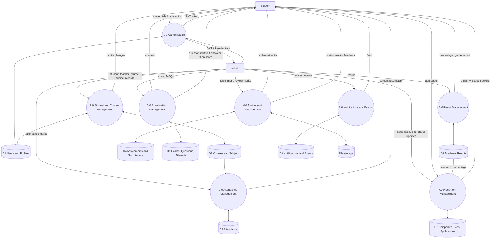

# Data Flow Diagrams - Smart Campus

## Level 0 (context diagram)

## Level 1

Notes: eligibility checking (7.0) reads the student's overall percentage from D6. Exam scoring (5.0) is performed on the server; the client sends only the selected options.
