# ER Diagram - Smart Campus

```mermaid
erDiagram
    USER ||--o| ADMIN : "has profile"
    USER ||--o| STUDENT : "has profile"
    USER |o--o| TEACHER : "may link to"
    USER ||--o{ PASSWORD_RESET_TOKEN : requests
    USER ||--o{ NOTIFICATION : publishes
    USER ||--o{ NOTE : uploads
    USER ||--o{ ASSIGNMENT : creates
    COURSE ||--o{ STUDENT : enrolls
    COURSE ||--o{ SUBJECT : contains
    COURSE }o--o{ JOB : "eligible for"
    TEACHER |o--o{ SUBJECT : teaches
    STUDENT ||--o{ ATTENDANCE : has
    SUBJECT ||--o{ ATTENDANCE : "recorded for"
    SUBJECT ||--o{ NOTE : has
    SUBJECT ||--o{ ASSIGNMENT : has
    ASSIGNMENT ||--o{ ASSIGNMENT_SUBMISSION : receives
    STUDENT ||--o{ ASSIGNMENT_SUBMISSION : submits
    SUBJECT ||--o{ EXAMINATION : has
    EXAMINATION ||--o{ QUESTION : contains
    EXAMINATION ||--o{ EXAM_ATTEMPT : "attempted as"
    STUDENT ||--o{ EXAM_ATTEMPT : takes
    EXAM_ATTEMPT ||--o{ EXAM_ANSWER : records
    QUESTION ||--o{ EXAM_ANSWER : "answered in"
    STUDENT ||--o{ ACADEMIC_RESULT : earns
    SUBJECT ||--o{ ACADEMIC_RESULT : "assessed in"
    COMPANY ||--o{ JOB : offers
    JOB ||--o{ JOB_APPLICATION : receives
    STUDENT ||--o{ JOB_APPLICATION : submits

    USER {
        string id PK
        string email UK
        string passwordHash
        enum role "STUDENT ADMIN TEACHER"
        enum status "ACTIVE INACTIVE"
        datetime createdAt
    }
    ADMIN {
        string id PK
        string userId FK
        string fullName
    }
    STUDENT {
        string id PK
        string userId FK
        string enrollmentNo UK
        string fullName
        string courseId FK
        int semester
        string phone
        string address
    }
    TEACHER {
        string id PK
        string userId FK
        string email UK
        string name
        string department
        string designation
    }
    COURSE {
        string id PK
        string name UK
        string code UK
        int semesters
    }
    SUBJECT {
        string id PK
        string courseId FK
        string teacherId FK
        string code
        string name
        int semester
    }
    ATTENDANCE {
        string id PK
        string studentId FK
        string subjectId FK
        date date
        enum status "PRESENT ABSENT LATE EXCUSED"
    }
    NOTE {
        string id PK
        string subjectId FK
        string uploadedById FK
        string title
        string fileKey
        string fileName
        int fileSize
    }
    ASSIGNMENT {
        string id PK
        string subjectId FK
        string createdById FK
        string title
        datetime deadline
        boolean allowLate
        int maxMarks
    }
    ASSIGNMENT_SUBMISSION {
        string id PK
        string assignmentId FK
        string studentId FK
        string fileKey
        enum status "PENDING SUBMITTED LATE REVIEWED"
        float marks
        string feedback
    }
    EXAMINATION {
        string id PK
        string subjectId FK
        string title
        datetime examDate
        int durationMinutes
        int totalMarks
        int passingMarks
        int maxAttempts
        boolean isPublished
    }
    QUESTION {
        string id PK
        string examId FK
        string text
        enum correctOption "A B C D"
        int marks
    }
    EXAM_ATTEMPT {
        string id PK
        string examId FK
        string studentId FK
        int attemptNo
        datetime startedAt
        datetime submittedAt
        float score
        boolean passed
    }
    EXAM_ANSWER {
        string id PK
        string attemptId FK
        string questionId FK
        enum selected "A B C D"
        boolean isCorrect
    }
    ACADEMIC_RESULT {
        string id PK
        string studentId FK
        string subjectId FK
        int semester
        enum examType "INTERNAL PRACTICAL MID_SEMESTER END_SEMESTER"
        float maxMarks
        float obtainedMarks
    }
    COMPANY {
        string id PK
        string name UK
        string website
        string industry
        string location
    }
    JOB {
        string id PK
        string companyId FK
        string title
        enum jobType "FULL_TIME INTERNSHIP PART_TIME CONTRACT"
        float minPercentage
        datetime deadline
        int openings
    }
    JOB_APPLICATION {
        string id PK
        string jobId FK
        string studentId FK
        enum status "APPLIED UNDER_REVIEW SHORTLISTED INTERVIEW SELECTED REJECTED"
        datetime appliedAt
    }
    NOTIFICATION {
        string id PK
        string createdById FK
        string title
        enum category "GENERAL ACADEMIC EXAMINATION PLACEMENT ASSIGNMENT EVENT"
        enum audience "ALL STUDENTS ADMINS"
    }
    EVENT {
        string id PK
        string title
        date eventDate
        string location
        string organizer
    }
    CONTACT_MESSAGE {
        string id PK
        string name
        string email
        string subject
        boolean isRead
    }
    PASSWORD_RESET_TOKEN {
        string id PK
        string userId FK
        string tokenHash UK
        datetime expiresAt
        datetime usedAt
    }
```

## Relationship notes

- **User → profile.** One `USER` row holds login credentials and role. A student or admin profile hangs off it one-to-one, so authentication stays in one table and role-specific data stays separate.
- **Course → Subject → everything academic.** A subject belongs to one course and one semester. Attendance, notes, assignments, examinations and results all reference a subject, so a student's content is found by matching the student's course and semester.
- **Attendance.** Unique on (student, subject, date), so re-marking a day updates the record instead of duplicating it.
- **Assignments.** Unique on (assignment, student): one submission per student, which may be replaced before the deadline.
- **Examinations.** An exam has many questions. Each attempt stores one `EXAM_ANSWER` per question, and `isCorrect` and the score are written by the server. Unique on (exam, student, attemptNo) enforces the attempt limit.
- **Results.** Unique on (student, subject, semester, exam type). Percentage and grade are calculated, not stored.
- **Placements.** A company offers many jobs. A job is eligible for many courses (many-to-many, empty means all). Unique on (job, student) prevents duplicate applications.
- **Delete rules.** Deleting a student cascades to their attendance, submissions, attempts, results and applications. Deleting a course or subject that is still referenced is blocked (`Restrict`) so data is never orphaned. Deleting a teacher only un-assigns their subjects (`SetNull`).
